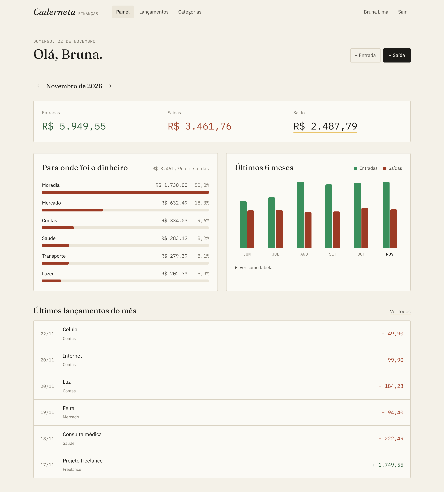
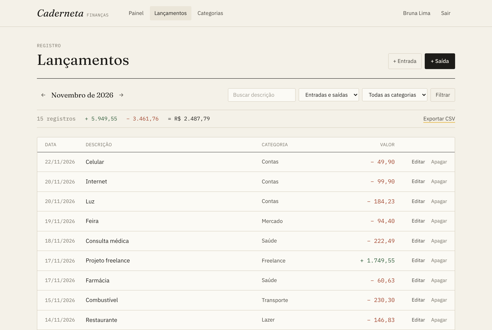
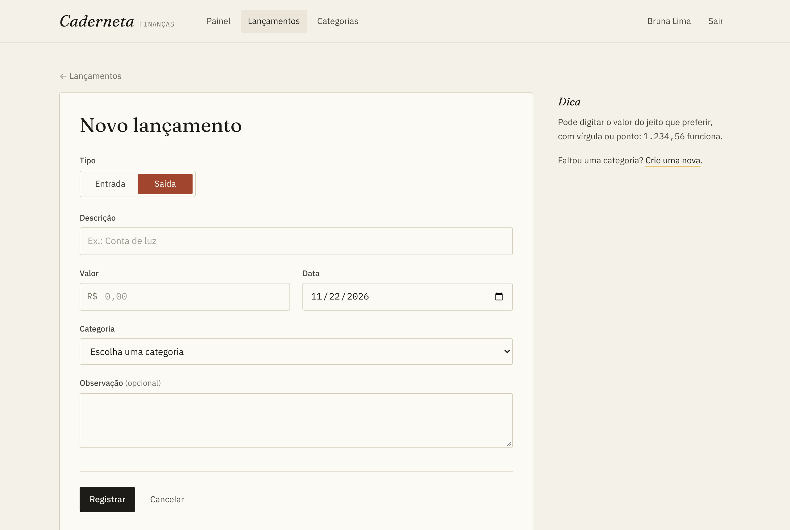
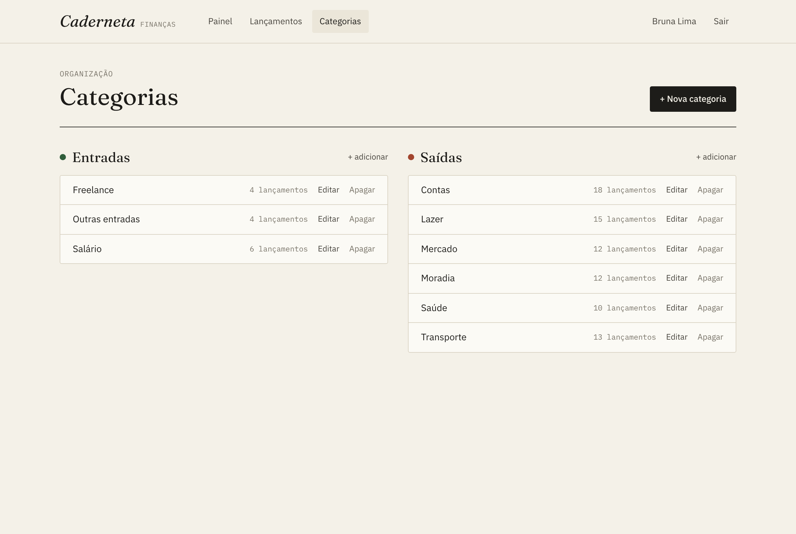
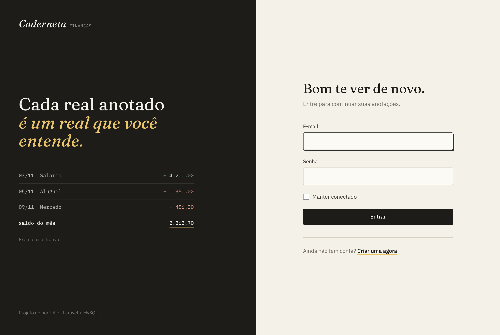

# Caderneta

[](https://github.com/oSerpa/financas/actions/workflows/testes.yml)

Controle financeiro pessoal feito com **Laravel 13** e **MySQL**. O usuário registra entradas e saídas, organiza por categoria e acompanha para onde vai o dinheiro mês a mês.

Projeto de portfólio, construído em etapas: autenticação, CRUD completo com regras de acesso, painel com gráficos e filtros, exportação e testes automatizados.



## Funcionalidades

- Cadastro e login com limite de tentativas contra força bruta.
- CRUD de **categorias** (entrada ou saída) e de **lançamentos**, cada usuário enxergando só os próprios dados.
- **Painel do mês** com entradas, saídas, saldo, gastos por categoria e comparação dos últimos 6 meses.
- **Filtros** por mês, tipo, categoria e busca por texto, com totais do filtro.
- **Exportação em CSV** pronta para abrir no Excel em português.
- Interface responsiva, em português, com identidade visual própria.

<table>
  <tr>
    <td></td>
    <td></td>
  </tr>
  <tr>
    <td></td>
    <td></td>
  </tr>
</table>

## Decisões técnicas

**O tipo do lançamento vem da categoria.** A tabela `transactions` não tem coluna de tipo: "Salário" é sempre entrada e "Mercado" é sempre saída. Isso elimina a possibilidade de um lançamento inconsistente e simplifica os filtros.

**Valor sempre positivo, sinal pela categoria.** O valor é `decimal(12,2)` (nunca `float`, para não perder centavos) e o sinal aparece só na exibição e no CSV.

**Autorização em duas camadas.** Policies impedem editar ou apagar dados de outro usuário (resposta 403), e o Form Request só aceita `category_id` que pertença a quem está logado.

**Integridade no banco, não só no código.** A chave estrangeira de categoria usa `restrictOnDelete`, então uma categoria com lançamentos não pode ser apagada nem por engano.

**Formato brasileiro de ponta a ponta.** O formulário aceita `1.234,56`, valores são exibidos como `R$ 1.234,56` sem depender da extensão `intl`, e o CSV usa `;` e vírgula decimal.

**Gráficos sem biblioteca.** As barras são HTML e CSS puros, com tooltip, versão em tabela para acessibilidade e cores testadas para daltonismo.

**URLs em português, código em inglês.** As rotas são `/lancamentos/novo` e `/categorias/1/editar`, enquanto models, controllers e nomes de rota seguem o padrão do Laravel.

## Tecnologias

- PHP 8.3 e Laravel 13
- MySQL 8
- Blade, Tailwind CSS 4 e Vite
- Pest para testes e Laravel Pint para estilo de código
- GitHub Actions rodando a suíte contra MySQL a cada push

## Como rodar localmente

Pré-requisitos: PHP 8.3+, Composer, Node 20+ e MySQL.

```bash
git clone https://github.com/oSerpa/financas.git
cd financas

composer install
npm install

cp .env.example .env
php artisan key:generate
```

Crie um banco chamado `caderneta` no MySQL e ajuste `DB_USERNAME` e `DB_PASSWORD` no `.env`. Depois:

```bash
php artisan migrate --seed
npm run build
php artisan serve
```

Acesse http://localhost:8000 e entre com a conta de demonstração:

| E-mail | Senha |
|---|---|
| `demo@caderneta.test` | `caderneta` |

O seeder cria seis meses de lançamentos de exemplo e pode ser rodado de novo (`php artisan db:seed`) para recriar a conta.

## Testes

```bash
php artisan test
```

Localmente os testes usam SQLite em memória, então não precisam do MySQL. No GitHub Actions a mesma suíte roda contra um MySQL 8.4 real.

## Estrutura principal

```
app/
├── Enums/TransactionType.php        entrada ou saída
├── Http/Controllers/                painel, lançamentos, categorias e autenticação
├── Http/Requests/                   validação dos formulários
├── Models/                          User, Category, Transaction
├── Policies/                        quem pode editar o quê
└── Support/                         Money (formatação) e MonthFilter (filtro por mês)
resources/views/                     telas em Blade e componentes
tests/                               testes em Pest
```
